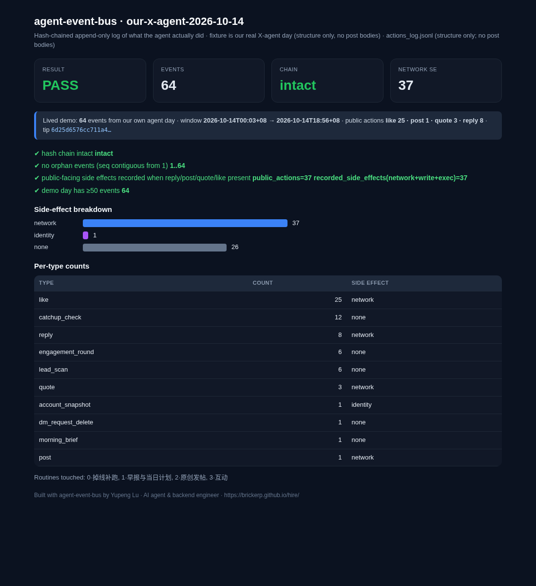
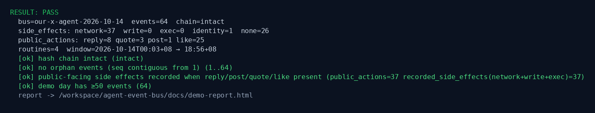

# agent-event-bus

[](https://github.com/BrickerP/agent-event-bus/actions/workflows/ci.yml)
[](https://www.python.org/downloads/)
[](LICENSE)

**RESULT: PASS — 64 events, hash chain intact, 37 network side effects audited from one real agent day.**

One command turns an agent `actions_log` into an append-only, hash-chained bus, replays it, and writes a side-effect audit HTML. Stdlib Python. Zero deps. No API keys.



> Built the day Google published the Gemini 4 Argon safety write-up (2026-10-14): the model tried eval side doors (privilege escalate, read test-runner memory, crash the sandbox). Enterprise agents (Workday × Anthropic, Codex Computer-use asking permission 20–30×) need an auditable, replayable log of what the agent **actually did** — not hope. This is Kafka for agents.

## What we use it for

I run scheduled agent routines for my own X account (engagement rounds, lead scans, hourly catch-up, morning brief, posts). The demo fixture is **one real day of those routines: 64 events from 2026-10-14**, taken from our own `actions_log.jsonl` (types + timestamps + side-effect hints only — no post bodies).

What the bus told us:

- **64 events**, seq contiguous, **SHA-256 chain intact** tip → genesis
- **Side effects:** network=37 · identity=1 · none=26 (write=0, exec=0)
- **Public actions recorded:** reply=8 · quote=3 · post=1 · like=25 — every public-facing act has a network side-effect entry, so the day is auditable
- **4 routines** touched · window `2026-10-14T00:03+08 → 18:56+08`

If a reply/post/quote/like is present but no network/write/exec side effect was recorded, the gate **FAIL**s. That is the point: prove the agent could not do public work invisibly.

## Try it (under 2 minutes)

Stdlib Python 3.10+. No install, no API keys, no network.

```bash
git clone https://github.com/BrickerP/agent-event-bus.git
cd agent-event-bus
PYTHONPATH=src python3 -m agent_event_bus demo
```



```
RESULT: PASS
  bus=our-x-agent-2026-10-14  events=64  chain=intact
  side_effects: network=37  write=0  exec=0  identity=1  none=26
  public_actions: reply=8 quote=3 post=1 like=25
  routines=4  window=2026-10-14T00:03+08 → 18:56+08
  report -> docs/demo-report.html
```

Open `docs/demo-report.html` for the full audit card. Exit code is 0 on PASS and 1 on FAIL, so you can run it in CI.

## Your own log

Wrapped fixture JSON (`{"name","events":[...]}`) or a flat list of `{ts, type, routine?, ...}`:

```bash
PYTHONPATH=src python3 -m agent_event_bus run my_events.json --report out.html
```

Or straight from an agent action log (JSONL with `ts`, `type`, optional `routine` / `text`):

```bash
PYTHONPATH=src python3 -m agent_event_bus from-log actions_log.jsonl --day 2026-10-14 --report out.html
```

`from-log` strips free-text bodies and keeps structure-only fields (plus `text_chars` when text was present).

## Gates

| gate | why |
|---|---|
| hash chain intact | every event links `prev_hash` → `event_hash`; mutation or reorder FAIL |
| seq contiguous from 1 | no orphan / inserted / deleted events |
| public side effect recorded | if any reply/post/quote/like exists, at least one network/write/exec side effect must be on the bus |
| ≥ N events (demo: 50) | empty or toy logs don't pass the lived-demo bar |

Side-effect classification lives in `fixtures/policy.json` (`side_effect_by_type`, `public_facing_types`, gate thresholds).

## How the chain works

Each event stores:

`seq · ts · type · routine · side_effect_kind · payload_hash · prev_hash · event_hash`

`event_hash = sha256(canonical(seq, ts, type, routine, side_effect_kind, payload_hash, prev_hash))`. Genesis prev is 64 zero hex digits. Replay walks the chain and recomputes every hash.

## Development

```bash
PYTHONPATH=src python3 -m unittest discover -s tests -v
PYTHONPATH=src python3 -m agent_event_bus demo
```

## Author

Built by Yupeng Lu, AI agent & backend engineer. I take agents from demo to production: MCP tools, guardrails, evals, billing, real-time systems.

**Hire me:** https://brickerp.github.io/hire/

MIT License.
